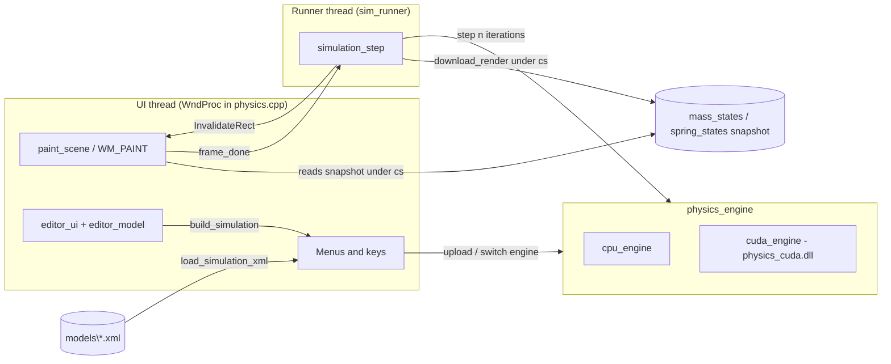

# Physics Simulator - Code Guide

How the code is organised, how it fits together, and how to extend it. For using the program see the
[user guide](USER_GUIDE.md).

## Contents

1. [Solution layout](#solution-layout)
2. [Architecture at a glance](#architecture-at-a-glance)
3. [Core data model](#core-data-model)
4. [The time step and the shared maths](#the-time-step-and-the-shared-maths)
5. [Engines](#engines)
6. [Threading and the main window](#threading-and-the-main-window)
7. [Simulation XML](#simulation-xml)
8. [The editor](#the-editor)
9. [Build system](#build-system)
10. [Tests](#tests)
11. [Extending the code](#extending-the-code)
12. [Known quirks](#known-quirks)

---

## Solution layout

`physics.sln` contains three projects. All are C++17 and use the v143 toolset.

| Project | Output | Contents |
|---|---|---|
| `physics/` | `physics.exe` (Win32 GUI; x64 and x86) | Window, rendering, XML loader, CPU engine, editor |
| `physics_cuda/` | `physics_cuda.dll` (x64 only) | The CUDA engine (`cuda_engine.cu`) |
| `physics_tests/` | `physics_tests.dll` (x64) | Native unit tests (CppUnitTestFramework) |

Source files in `physics/`:

| File | Role |
|---|---|
| `physics.cpp`, `physics.h`, `physics.rc`, `resource.h`, `framework.h`, `targetver.h` | Application entry, window procedure, rendering, mode switching (run/edit), engine selection |
| `vector2.h` | Header-only 2D vector; every method is `__host__ __device__` when compiled by nvcc |
| `constants.h` | Physical constants (`G`, Earth/Moon/Sun values) |
| `mass.h`, `spring.h`, `damper.h`, `model_system.h` | Immutable description of the bodies and constraints |
| `simulation.h` | `simulation` (model + world settings), the per-body state structs, `wall_flags` |
| `physics_math.h` | The per-pair formulas, shared by both engines |
| `physics_engine.h` | The `physics_engine` interface, engine factory declarations |
| `cpu_engine.h/.cpp` | CPU implementation of the engine |
| `engine_factory.cpp` | `make_cpu_engine`, `make_engine` fallback logic, a CPU-only stub for 32-bit builds |
| `sim_runner.h` | The simulation worker thread and its pacing against the UI |
| `info_format.h` | Text formatting for the info label (header-only, unit tested) |
| `simulation_xml.h/.cpp` | XML loader (XmlLite), text loader, and writer |
| `editor_model.h/.cpp` | The editable document, selection, undo/redo, clipboard text (no Windows code) |
| `editor_ui.h/.cpp` | Editor menus, mouse/keyboard tools, Properties window, painting, file and colour dialogs |
| `coordinate_translation.h` | `viewport`, the world-to-screen mapping used by run-mode drawing |
| `models/` | The nine bundled simulations as XML; copied next to the exe by the build |

## Architecture at a glance



- The window always draws from a **snapshot** of positions, velocities and broken flags. The engine owns
  the real state (on the CPU or the GPU).
- The runner thread is the only thread that calls the engine while the simulation runs. The UI thread only
  touches the engine while the runner is stopped (switching engines, loading a simulation, entering
  the editor).

## Core data model

All of this is plain data with no behaviour beyond simple accessors.

- **`mass`** (`mass.h`): mass `m`, radius `r`, elasticity `e`, optional display colour (`0xRRGGBB`).
- **`spring`** (`spring.h`): two mass indices, `k`, rest length `l0`, break factors (default 0.5 and 1.5),
  optional colour. `min_length()` / `max_length()` are `l0` times the factors.
- **`damper`** (`damper.h`): two mass indices, `k`, `l0` (stored, unused by the forces).
- **`model_system`**: vectors of the three above.
- **`simulation`** (`simulation.h`): a `model_system` plus the world bounds, `dt`, `iterations_per_update`,
  `min_gravitational_mass` and `wall_flags` (which edges bounce; bottom is on by default). It describes a
  system but holds no changing state and has no stepping code.
- **State structs** (`mass_state`, `spring_state`, `damper_state`): position, velocity, force,
  acceleration, fixed flag, and the `broken_` flags. These are the host-side representation used to move
  state in and out of engines, and for drawing.

Indices into the vectors identify bodies. Constraints refer to masses by index, so anything that removes
masses must renumber constraints (the editor does this in `delete_selection`).

## The time step and the shared maths

One step is the same on both engines (`physics_engine::step`):

```
update_broken -> compute_gravity -> compute_springs -> compute_dampers
              -> sum_forces -> integrate -> collisions -> walls
```

Each force generator writes its **own per-mass force array**; `sum_forces` adds them as
`(gravity + spring) + damper` and sets `acceleration = force / m`. Integration is semi-implicit Euler
(`v += a dt`, then `x += v dt`), skipped for fixed masses.

`physics_math.h` holds the per-pair formulas: `gravity_pair`, `spring_pair_force`, `damper_pair_force`,
`collision_pair`, `wall_bounce`, and the spatial-hash helpers. Both engines call these exact functions, so
there is one definition of the physics. What differs between the engines is only the **loop structure**,
and the design keeps that structure deterministic:

- Forces are computed per mass ("gather"), not scattered with atomics. Each mass sums contributions in
  ascending partner or constraint index, which is also the order the CPU produces.
- For a pair, the formula is always evaluated with the lower-indexed mass first; the other mass takes the
  negation. This keeps signs and rounding identical.
- Collisions are evaluated from start-of-pass state; every mass sums its own contacts in ascending partner
  index and the deltas are applied afterwards (no in-place order dependence).
- The tests build with `/fp:precise` and the CUDA project with `--fmad=false`, so results match **bit for
  bit**, not just approximately.

**Collisions** use a uniform grid with cell size `2 * max radius`. Cell keys come from
`physics_math::cell_key`. Candidate partners come from the 3x3 neighbouring cells. The CPU builds an
`unordered_map` and sorts each mass's candidates; the GPU sorts masses by key with `thrust` and does a
nine-way merge of the neighbouring runs to visit partners in ascending index.

**Walls**: `wall_bounce(position, velocity, radius, bounds, flags)` checks bottom, top, left, right in that
order. The bottom branch is the original "floor" code, bit for bit. Positions are not corrected.

## Engines

### Interface (`physics_engine.h`)

```cpp
upload(sim, masses, springs, dampers);   download(...);   download_render(...);
update_broken(); compute_gravity(); compute_springs(); compute_dampers();
sum_forces(); integrate(dt); collisions(); walls();
read_forces(generator, out);   synchronize();   step(iterations, dt);
```

Every stage is public so tests can compare engines stage by stage. `download` returns everything;
`download_render` returns only what drawing needs, to keep the per-frame cost low.

`make_engine(kind, error)` returns the requested engine, falling back to the CPU engine (and filling
`error`) if CUDA is unavailable. `make_cuda_engine` and `cuda_device_names` live in the DLL
(`PHYSICS_CUDA_API` expands to `dllexport`/`dllimport`; 32-bit builds get a stub in `engine_factory.cpp`).

### CPU engine (`cpu_engine.cpp`)

State is held as separate arrays (positions, velocities, accelerations, one force array per generator,
fixed flags). Gravity is a pair scatter (`i < j`), which for each mass adds partners in ascending order, the
same sequence the GPU gather uses.

### CUDA engine (`physics_cuda/cuda_engine.cu`)

- **Device choice:** the lowest FP32:FP64 ratio wins (so Titan-class cards beat GeForce); the
  `PHYSICS_CUDA_DEVICE` environment variable overrides it.
- **Per-thread binding:** `cudaSetDevice` applies to the calling host thread, and the runner thread is
  recreated whenever the simulation changes. Every public method therefore calls `bind()` first.
- **Memory:** `dev_array<T>` RAII wrappers for positions, velocities, accelerations, the four force arrays,
  mass parameters, spring and damper parameters and flags, and collision scratch buffers.
- **Topology:** at upload, springs and dampers are turned into CSR adjacency lists per mass (sorted by
  constraint index), plus a spring-to-dampers list used when a spring breaks.
- **Kernels:** `kernel_update_broken`, `kernel_gravity` (shared-memory tiles over `j`, ascending),
  `kernel_springs`, `kernel_dampers`, `kernel_sum_forces`, `kernel_integrate`, `kernel_cell_keys` +
  `thrust::stable_sort_by_key`, `kernel_collide`, `kernel_apply_collisions`, `kernel_walls`.
- **Errors:** every CUDA call goes through `CUDA_CHECK`, which throws; the factory turns a failure at
  creation into a CPU fallback, and a failure while running is reported by the runner (see below).
- The kernels are asynchronous on the default stream; `synchronize()` (called at the end of `step`) waits.

## Threading and the main window

`physics.cpp` owns the globals: `sim`, the snapshot vectors, the engine, the `sim_runner`, the critical
section `cs` that guards the snapshot, and the `editing` flag.

**`sim_runner`** (`sim_runner.h`) runs `simulation_step` on a worker thread. After each step it asks for a
repaint and waits (with a timeout) for the UI to call `frame_done()`, so the simulation advances once per
displayed frame. `stop()` always returns: it sets a flag under a mutex, wakes the worker, and joins it.

Two design points came from real bugs:

- The worker never blocks on the UI thread. An earlier version used `SendMessage` to repaint while the UI
  thread waited to join the worker; that deadlocked on simulation switches.
- The repaint is requested with `InvalidateRect` and drawn in `WM_PAINT`, not with `PostMessage`. Posted
  messages are delivered before mouse and keyboard input, so a fast simulation starved the menus.
  `WM_PAINT` is delivered only when the input queue is empty.

**Engine failure:** if a step throws, the worker records the message and posts `WM_USER + 2`. The UI thread
stops the runner, shows the error and continues on the CPU engine from the last snapshot.

**Info label:** `draw_info_label` (DirectWrite, Segoe UI, on a translucent backing; a GDI version exists
for the fallback renderer) shows the engine, FPS and simulation time. `simulation_clock` is a
`std::atomic<double>` advanced by the runner thread by `dt * iterations` per frame and reset when a
simulation is loaded or run. FPS is the rate of `WM_PAINT` completions measured over half-second windows
(`update_fps`).

**Switching:** engine and simulation switches always `stop()` the runner, change state on the UI thread,
then `start()` again. `WM_CLOSE` stops the runner before destroying the engine.

**Drawing (`paint_scene`)**: copies the snapshot under `cs`, then draws with Direct2D (GDI is a
fallback). Masses are red, or blue if fixed, with a green outline; custom colours replace both. Masses
under 1.5 pixels are drawn as tiny rectangles and off-screen masses are skipped. In edit mode
`editor_ui::paint` draws instead. The viewport maps the world bounds, scaled by the zoom factor and the
window's aspect ratio, onto the client area; the editor uses the identical mapping (`make_editor_view`).

## Simulation XML

`simulation_xml.cpp` reads with **XmlLite** (built into Windows, no extra dependency).

- The reader is a pull parser; elements are checked by depth (`simulation` > `masses`/`springs`/
  `dampers` > leaf). Each element's attributes go into an `attributes` helper that parses numbers, flags
  and colours and **rejects any attribute it did not consume**.
- Numbers are parsed with `_strtod_l` in the C locale. The writer uses `std::to_chars`, which gives the
  shortest text that reads back to exactly the same `double`, so save/load round trips are exact.
- Index ranges, self-connections and value ranges are validated after parsing. Errors carry the file name
  and line number. Output vectors are modified only when the whole file loaded.
- Entry points: `load_simulation_xml(path, ...)`, `load_simulation_xml_text(text, ...)` (used for the
  clipboard), `simulation_to_xml`, `save_simulation_xml`.
- The writer omits attributes that equal their defaults.

The format is documented in the [user guide](USER_GUIDE.md#the-xml-file-format) and in the comment at the top
of `simulation_xml.h`.

## The editor

### `editor_model` (no Windows code)

- `editor_document`: world settings (including wall flags), masses, springs, dampers.
- `editor_selection`: sets of selected mass, spring and damper indices.
- Conversion: `document_from_simulation` and `build_simulation`.
- Hit testing in world units: `pick_mass`, `pick_connection` (all springs and dampers on the nearest pair),
  `masses_in_rect`.
- Edits: `add_mass`, `connect`, `delete_selection` (removes dangling constraints and renumbers),
  `edit_masses`, `edit_connections`, `edit_world` (all validated and atomic: a bad value changes nothing),
  `move_selection` and `set_velocity` for drags.
- **Undo/redo** keeps whole-document snapshots (limit 50). Discrete edits push a snapshot themselves;
  drags call `begin_gesture()` once and then mutate freely, so a drag is one undo step.
- **Clipboard:** `copy_selection` builds a fragment document (selected masses and the constraints between
  them), builds a `simulation` from it and serialises with `simulation_to_xml`. `paste_at` / `paste_offset`
  parse the text with the real loader, append the masses with shifted indices and select them. This means
  the clipboard format and the file format are the same thing and share validation.

### `editor_ui`

- `create()` appends the Editor and Edit menus to the existing menu bar and creates the Properties window
  (so `physics.rc` needs no changes). `editor_host` is the small set of callbacks the editor needs from the
  application (repaint, current view, enter edit mode, state changed).
- **Mouse state machine:** `drag_kind::{none, move, marquee, velocity}`. Gestures start lazily on the first
  actual movement so a plain click does not create an undo step. The mouse is captured for the duration of
  a drag.
- **Tools:** select, place, spring, damper, both. Keys are handled in `on_key_down`; menu commands in
  `command()`. Run is left to `physics.cpp`.
- **Properties window:** a floating tool window (a docked child window can be hidden by the Direct2D
  surface). Fields are ordinary `EDIT` controls subclassed to handle Enter, Tab and Esc; a field is applied
  on `EN_KILLFOCUS` if its text changed. `refresh_panel()` shows the shared value of the selection or blank
  for mixed values. Colour swatches are owner-drawn buttons that open the system `ChooseColor` dialog.
- **Files:** standard open/save dialogs; `confirm_discard()` is used by New, Open and closing the window.

### Mode switching (`physics.cpp`)

`enter_edit_mode()` stops the runner and shows the editor. `run_document()` builds a `simulation` from the
document, replaces `sim` and the snapshot, uploads to the engine and restarts the runner. The document is
never modified by running.

## Build system

- Open `physics.sln`, or run `MSBuild physics.sln /p:Configuration=Release /p:Platform=x64`.
- Output goes to `x64\<Configuration>` next to the solution (the DLL, exe and tests together). The `models`
  folder is copied there by a `CopyModels` target in both the exe and test projects.
- **CUDA:** `physics_cuda.vcxproj` imports the CUDA 12.6 props and targets and links `cudart_static`. It is
  x64 only and compiles for `sm_70` (Volta, e.g. Titan V) and `sm_86` (Ampere, e.g. RTX 3080 Ti) with
  `--fmad=false` and `-std=c++17`. **Do not use CUDA 13.0** to build: it dropped Volta. Change
  `CodeGeneration` in the project to target other GPUs.
- **32-bit** configurations build the exe without the DLL; `engine_factory.cpp` supplies a stub that
  reports CUDA as unavailable.
- `physics.rc` is UTF-16; edit it with Visual Studio's resource editor, not a plain text tool. The editor
  and engine menus are created in code for this reason.

## Tests

Run with the VS Test Explorer or:

```
vstest.console.exe x64\Release\physics_tests.dll
```

| File | Covers |
|---|---|
| `cuda_regression_tests.cpp` | CPU vs CUDA, stage by stage and over many steps, for random systems and every bundled simulation, on every GPU; walls on all edges; engine switching mid-run |
| `cpu_sanity_tests.cpp` | Physics checks that need no GPU: momentum conservation, no residual overlap, Newton's gravity, each wall's bounce factors, spring period |
| `xml_loader_tests.cpp` | Loader, writer, defaults, round trips, colours, walls, and rejection of invalid files |
| `editor_model_tests.cpp` | Editing, delete renumbering, copy/paste/cut/duplicate, undo/redo, hit testing, colours, wall flags, bundled models surviving the editor unchanged |
| `sim_runner_tests.cpp` | `stop()` never hangs (regression for the old deadlock), frame pacing, start/stop cycles |

Helpers: `test_support.h` (seeded random scenario builder, comparers, `require_cuda`),
`simulation_compare.h` (exact comparison of two simulations), `model_files.h` (locates `models` next to the
test DLL).

Conventions:

- CPU-vs-CUDA comparisons require **exact** equality (`rel = 0`). Any difference is a real bug.
- The CUDA tests **fail** (rather than skip) when no usable GPU is present, so a regression run cannot pass
  by silently skipping.
- The UI itself is not unit tested; the editor logic lives in `editor_model` so that it can be.

## Extending the code

**Add a force generator** (for example wind or drag):

1. Add a `force_generator` value and a per-mass array in `cpu_engine` and `cuda_engine`.
2. Put the per-mass formula in `physics_math.h`.
3. Add `compute_x()` to `physics_engine`, implement it on both engines (CPU loop, CUDA gather kernel),
   include the new array in `sum_forces` in a fixed order, and call it from `step`.
4. Add `CPU == CUDA` exact tests like the existing generator tests.

**Add a new XML attribute or per-body property:**

1. Add the field to the model class (`mass`, `spring`, or `simulation`) with a default that preserves old
   behaviour.
2. Read it in `read_simulation` (and validate), write it in `simulation_to_xml`.
3. Carry it through `editor_document`, `document_from_simulation`, `build_simulation`, and the compare helper
   in the tests.
4. Add a Properties window control (see the existing colour or wall rows) and drawing if it is visual.
5. Add loader, writer round-trip and editor tests.

**Add a bundled simulation:** drop `simulationN.xml` into `physics/models` (it is copied on build) and add
a menu item and `ID_SIMULATIONn` for it in `physics.rc` and `resource.h`.

**Target another GPU:** add the architecture to `CodeGeneration` in `physics_cuda.vcxproj`.

## Known quirks

- Collisions are applied to fixed masses too, so a fixed mass can be nudged.
- Walls do not move masses back inside; they only force the velocity inward.
- Jacobi-style collision resolution sums the corrections from every overlapping neighbour, so a mass
  squeezed between several others can be pushed further than a one-at-a-time solver would.
- The editor draws with Direct2D only; if Direct2D is unavailable the canvas is blank in edit mode.
- The Properties window does not scroll, so very small screens cut off its lower rows.
- `damper::l0` is saved and loaded but does not affect the forces.
